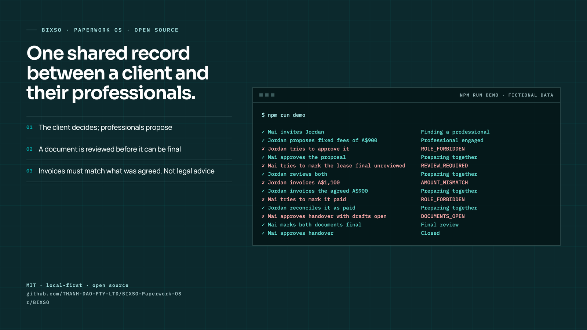

# BIXSO Paperwork OS



One shared record of a paperwork matter between a client and the professionals helping them, such as a lawyer, accountant, conveyancer or agent. Everyone works from the same document checklist, decisions and invoice records, and the client stays in charge.

- **The client decides.** Professionals submit proposals, engagement terms, milestones and handovers. Only the client who owns the matter approves or declines them.
- **Documents have a clear path.** Each item moves `needed → drafted → shared → reviewed → final`. A professional reviews a document before the client can mark it final, and a final document is not edited.
- **Agreements are versioned.** Each new proposal is a new version. The agreement changes only when the client approves.
- **Invoices match what was agreed.** An invoice must equal the approved proposal. A client's "I transferred it" is recorded as a claim for the exact amount, with a date and reference. Only the professional who issued the invoice reconciles that claim to paid, and can void an invoice only before the client accepts it.
- **Handover closes the matter** only when every document on the checklist is final.
- **Every action is on the timeline**, and checklists and invoices export to CSV.

## Who it's for

- **Builders:** developers of client portals for lawyers, accountants, conveyancers and agents can use the matter, document and invoice rules.
- **Professionals and their clients:** tell us which step in your matters doesn't fit.

<!-- bixso-os-origin:start -->
## Where this comes from

These rules come from **[LawsFinder](https://lawsfinder.com)**, a platform for legal procedures and the professionals who handle them that BIXSO builds and runs. This repository is the open concept and a lite reference implementation of its rules: plain functions, local files and no accounts. The product adds what a real service needs, such as accounts, hosting and support, and it is still being built.

Ideas and changes made here are reviewed for LawsFinder as well. See this project's [roadmap](docs/ROADMAP.md) and [how BIXSO OS is run](https://github.com/THANH-DAO-PTY-LTD/.github/blob/main/GOVERNANCE.md).
<!-- bixso-os-origin:end -->

## Not advice, not a vault

Paperwork OS is a free record-keeping tool. It contains no legal, tax or financial content and does not give advice. It does not create legally binding signatures, hold or move money, or verify who anyone is. Talk to a qualified professional about your situation.

The software is provided under the MIT license. Nothing in that license or in this repository excludes, restricts or modifies any right or remedy you have under the Australian Consumer Law, or any other law, that cannot lawfully be excluded.

## Try it

Use Node.js 22 or later. There are no dependencies to install.

```sh
npm test
npm run demo
```

The demo follows a fictional café owner renewing a shop lease, including the steps the record refuses.

Run your own matter from the command line. Matters are saved in `.paperwork-os/<id>.json` in the current folder.

```sh
node bin/paperworkos.js new lease --client Mai --title "Lease renewal"
node bin/paperworkos.js invite lease Jordan --as client:Mai
node bin/paperworkos.js accept lease Jordan
node bin/paperworkos.js submit lease proposal "Review and negotiate" --amount 900 --as professional:Jordan
node bin/paperworkos.js decide lease dec-1 approve --as client:Mai
node bin/paperworkos.js help
```

## Limits of this preview

- One computer, one file per matter, with no accounts, sharing, locking or backup. `--as` is typed, not authenticated, and anyone using the command line can accept an invite.
- Documents are tracked by title and status. Files themselves are not stored.
- Use fictional records. Do not put real client documents or personal information in this preview or in issues.

## Use it as a library

```js
import { createMatter, inviteProfessional } from './src/matter.js'
```

Every function returns a new matter and leaves the previous one unchanged.

## Help shape it

Open an [issue](https://github.com/THANH-DAO-PTY-LTD/BIXSO-Paperwork-OS/issues) if a step does not match how your matters run. See [CONTRIBUTING](CONTRIBUTING.md) and the [security policy](SECURITY.md).

<!-- bixso-os-family:start -->
## BIXSO OS family

Small, local-first, MIT-licensed tools for running real work, each built from the rules of a BIXSO product.

| Project | What it does |
| --- | --- |
| [BIXSO Service OS](https://github.com/THANH-DAO-PTY-LTD/BIXSO-Service-OS) | Run a one-person service business: Company, Flow and Work in a local web app. |
| [BIXSO Sourcing OS](https://github.com/THANH-DAO-PTY-LTD/BIXSO-Sourcing-OS) | B2B sourcing workflows from RFQ to delivered order, with a receipt for every step. |
| [BIXSO Consulting OS](https://github.com/THANH-DAO-PTY-LTD/BIXSO-Consulting-OS) | An evidence-first record of a consulting engagement. |
| [BIXSO Construction OS](https://github.com/THANH-DAO-PTY-LTD/BIXSO-Construction-OS) | An outdoor or landscape job from site survey to handover. |
| [BIXSO Paperwork OS](https://github.com/THANH-DAO-PTY-LTD/BIXSO-Paperwork-OS) (this project) | One shared record of a paperwork matter between a client and their professionals. |
| [BIXSO Travel OS](https://github.com/THANH-DAO-PTY-LTD/BIXSO-Travel-OS) | Trip plans where every suggestion explains itself, plus traveller-host meetups. |
| [BIXSO Sport OS](https://github.com/THANH-DAO-PTY-LTD/BIXSO-Sport-OS) | Community pickup games with a fair waitlist, check-in and results. |
| [BIXSO Social OS](https://github.com/THANH-DAO-PTY-LTD/BIXSO-Social-OS) | Connections and a trust ledger that moves only on independent receipts. |
| [BIXSO Academy OS](https://github.com/THANH-DAO-PTY-LTD/BIXSO-Academy-OS) | Learning evidence where AI gives feedback and people verify. |

Release news, questions and ideas: [r/BIXSO](https://www.reddit.com/r/BIXSO/).

## Work with BIXSO

Want this set up for your business, or shaped around how your team actually works? BIXSO provides business workflow advisory and implementation. See [bixso.ai](https://bixso.ai/?utm_source=github&utm_medium=readme&utm_campaign=bixso-os&utm_content=paperwork-os).
<!-- bixso-os-family:end -->

## License

[MIT](LICENSE) · Copyright (c) 2026 Thanh Dao Pty Ltd. See [docs/PROVENANCE.md](docs/PROVENANCE.md).

BIXSO and the BIXSO logo are trademarks of Thanh Dao Pty Ltd. The MIT license covers the code, not the names or logo; see [TRADEMARKS.md](TRADEMARKS.md).
